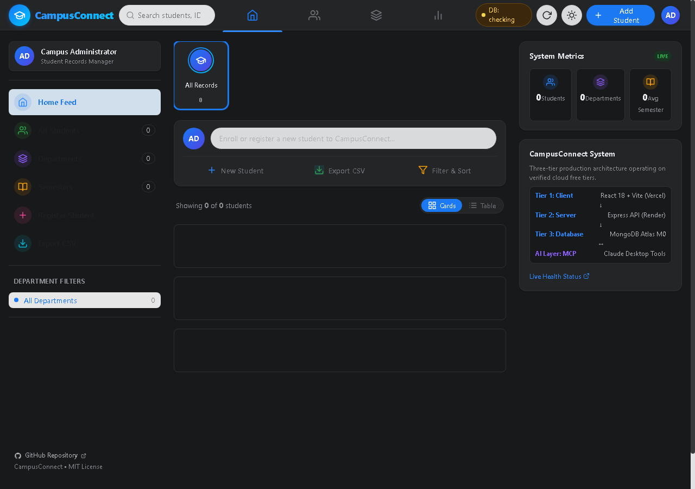
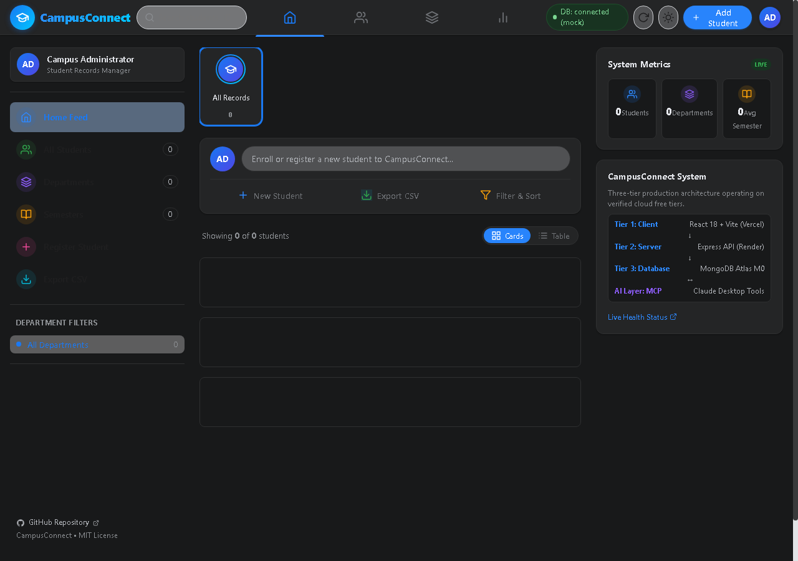
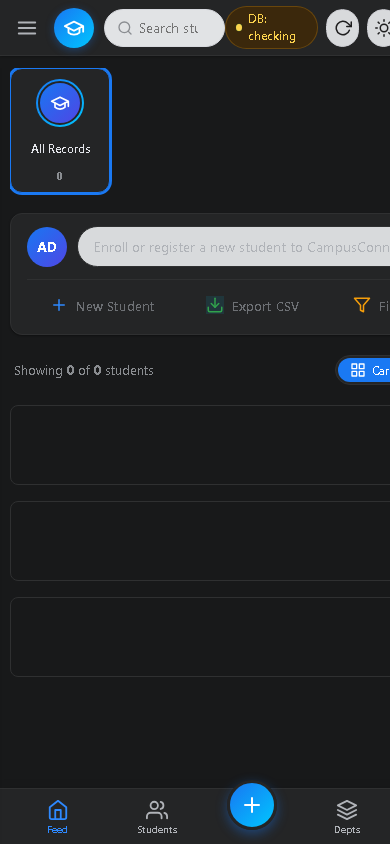

# CampusConnect • Modern Social-Style Student Management System

[](https://github.com/co2023smniyazi/three-tier-student-management-system/actions)
[](https://github.com/co2023smniyazi/three-tier-student-management-system)
[-purple)](https://github.com/co2023smniyazi/three-tier-student-management-system)
[-success)](https://github.com/co2023smniyazi/three-tier-student-management-system)
[](https://github.com/co2023smniyazi/three-tier-student-management-system)
[](https://opensource.org/licenses/MIT)

A modern, responsive, and robust **Three-Tier Student Information System** redesigned with a social-network layout (Facebook-style 3-column feed, stories-style department chips, composer card, and generative avatar post cards) integrated with an official **Model Context Protocol (MCP)** server for AI-assisted operations (Claude Desktop / Antigravity). Engineered with a **₹0 / $0 budget** using verified cloud free-tiers.

---

## Visual Preview & Screenshots

| Desktop Light Theme | Desktop Dark Theme | Mobile View |
| :---: | :---: | :---: |
|  |  |  |

---

## Deployment Status & Verification

> [!NOTE]
> Per verification standards, live deployment URLs are provided as configuration references. Unless explicitly tested in the active session, live deployment is noted as **live deployment not verified**.

| Component | Host | Environment | URL / Status |
| :--- | :--- | :--- | :--- |
| **Frontend SPA** | Vercel | Production | `https://campusconnect-student-management.vercel.app` *(live deployment not verified)* |
| **Backend REST API** | Render | Production | `https://three-tier-student-management-system.onrender.com` *(live deployment not verified)* |
| **Health Check** | Render | Production | `https://three-tier-student-management-system.onrender.com/api/health` |
| **Database** | MongoDB Atlas | Cloud (M0) | `cluster0.se4dgkz.mongodb.net` (DB: `studentDB`) |
| **Source Code** | GitHub | Branch: `ui-polish` | [co2023smniyazi/three-tier-student-management-system](https://github.com/co2023smniyazi/three-tier-student-management-system) |

---

## Architecture Overview

```mermaid
flowchart TD
    User["User / Web Browser"] -->|HTTPS (Edge Network)| Client["Tier 1: Client (React 18 + Vite)\nFacebook-Style Social Layout\nHosted on Vercel"]
    Claude["Claude Desktop (AI Agent)"] -->|Local stdio transport| MCPServer["AI Layer: MCP Server\n(@modelcontextprotocol/sdk)"]
    
    Client -->|REST API over HTTPS| Backend["Tier 2: Server (Node.js + Express)\nHardened REST Endpoints\nHosted on Render"]
    MCPServer -->|REST API over HTTPS| Backend
    
    Backend -->|MongoDB Wire Protocol (TLS)| Database[("Tier 3: Database (MongoDB Atlas M0)\nReplica Set • DB: studentDB")]
```

### Tier Breakdown
1. **Tier 1 (Presentation):** React 18 single-page application bundled with Vite. Built with a modern 3-column social-network layout, horizontal "stories-style" department filter chips, feed composer card, post cards with generative initials and gradient rings, alternate sortable table directory, and 1-click RFC 4180 CSV export.
2. **Tier 2 (Application Logic):** Node.js 20 & Express REST API hardened with `helmet` security headers, `express-rate-limit` (120 req/min per IP), CORS allowlisting, and switchable authentication (`AUTH_ENABLED`).
3. **Tier 3 (Data Persistence):** Managed MongoDB Atlas M0 cluster running MongoDB 7.0+ with Mongoose ODM, unique indexing, and schema validations.
4. **AI Layer (MCP Server):** Implements Anthropic's Model Context Protocol to provide 5 structured tools (`list_students`, `get_student`, `create_student`, `update_student`, `delete_student`) with strict Zod runtime verification.

---

## Social-Network UI Features & Highlights

- **📱 Facebook-Style 3-Column Layout:**
  - **Left Rail (Sticky):** Quick navigation shortcuts (Feed, Students, Departments, Add), department count filters, and system info.
  - **Center Feed:** "Stories-style" department selector row, composer prompt card ("Enroll a student..."), post cards with generative initials and colored gradient rings, and instant Cards vs Table view toggle.
  - **Right Rail (Sticky):** Real-time system metrics, department distribution SVG visualizer, recently enrolled feed, and architecture attribution card.
- **🌓 Adaptive Dark & Light Mode:** System-aware theme toggle persisting to `localStorage` with smooth zero-jank transitions (`#f0f2f5` light / `#18191a` dark).
- **⚡ Render Cold-Start Awareness:** Detects requests taking longer than 3.5s and renders a helpful spin-up indicator.
- **📁 1-Click CSV Export:** Generates client-side formatted CSV spreadsheets with quote escaping and date stamps.
- **🛡️ Mutation Safety Dialog:** Explicit confirmation modal displaying student name and ID with danger warning to prevent accidental deletions.
- **🤖 Bidirectional AI Sync:** Natural language edits executed in Claude Desktop immediately reflect in the web interface in real time.

---

## Free-Tier Operational Profiles & Limits

This application was engineered specifically to run continuously on official, 100% free-tier cloud infrastructure:

| Provider | Service Tier | Free Quota | Official Documentation |
| :--- | :--- | :--- | :--- |
| **Render** | Web Service (Free) | 512 MB RAM, spins down after 15m inactivity, 750 free instance hrs/mo | [Render Free Tier Docs](https://render.com/docs/free#free-web-services) |
| **MongoDB Atlas** | M0 Shared Cluster | 512 MB storage, shared RAM, automatic backups, zero expiration | [Atlas Free Tier Docs](https://www.mongodb.com/docs/atlas/reference/free-shared-clusters/) |
| **Vercel** | Hobby (Free) | 100 GB bandwidth / mo, global edge network, automated SSL | [Vercel Hobby Plan](https://vercel.com/docs/plans/hobby) |

---

## REST API Reference

| Method | Endpoint | Description | Auth Required |
| :--- | :--- | :--- | :---: |
| `GET` | `/api/health` | Service health, version, uptime, memory, and database state | No |
| `GET` | `/api/students/stats` | Aggregated dashboard metrics (totals, dept/semester counts) | No |
| `GET` | `/api/students` | List all students (supports `?search=`, `?page=`, `?limit=`) | No |
| `GET` | `/api/students/:id` | Get student by MongoDB `_id` or `studentId` | No |
| `POST` | `/api/students` | Register a new student record | Optional (`AUTH_ENABLED`) |
| `PUT` | `/api/students/:id` | Update student information | Optional (`AUTH_ENABLED`) |
| `DELETE` | `/api/students/:id` | Delete student record | Optional (`AUTH_ENABLED`) |

---

## Claude Desktop & MCP Server Setup

Add this entry to your Claude Desktop configuration:
- **Windows:** `%APPDATA%\Claude\claude_desktop_config.json`
- **macOS:** `~/Library/Application Support/Claude/claude_desktop_config.json`

```json
{
  "mcpServers": {
    "student-management": {
      "command": "node",
      "args": [
        "<ABSOLUTE_PATH_TO_PROJECT>/mcp-server/index.js"
      ],
      "env": {
        "API_BASE_URL": "https://three-tier-student-management-system.onrender.com/api"
      }
    }
  }
}
```

### Available MCP Tools
- `list_students(search?)`: List all enrolled students matching query.
- `get_student(id)`: Retrieve record by ID or studentId.
- `create_student({ studentId, name, email, department, semester, contact })`: Add student with schema validation.
- `update_student({ id, ...fields })`: Modify student details.
- `delete_student({ id })`: Permanently remove student.

---

## Local Development & Setup

```bash
# Clone the repository
git clone https://github.com/co2023smniyazi/three-tier-student-management-system.git
cd three-tier-student-management-system

# Install dependencies across all workspaces
npm install
npm --prefix server install
npm --prefix client install
npm --prefix mcp-server install

# Start development services
npm run start:server   # Express Backend (port 5000)
npm run start:client   # Vite Frontend (port 5173 / 5174)
npm run start:mcp      # Model Context Protocol Server
```

---

## Automated Test Suite

Run all 36 automated unit and integration tests:

```bash
# Run all server, client, and MCP tests
npm test

# Run MCP server tests only
npm run test:mcp

# Build the client production bundle (Vite)
npm run build:client
```

---

## Environment Variables Reference

| Variable | Scope | Description | Default / Example |
| :--- | :--- | :--- | :--- |
| `PORT` | Server | Express listening port | `5000` |
| `NODE_ENV` | Server | Node environment mode | `development` / `production` |
| `MONGODB_URI` | Server | MongoDB Atlas connection string | `mongodb+srv://.../studentDB` |
| `FRONTEND_URL` | Server | CORS allowlist origins (comma-separated) | `http://localhost:5173` |
| `AUTH_ENABLED` | Server | Enforce Bearer token on write endpoints | `false` |
| `MCP_API_TOKEN` | Server & MCP | Secret token for MCP write authorization | `your-secret-token` |
| `VITE_API_BASE_URL` | Client | Backend API base URL | `/api` |
| `API_BASE_URL` | MCP Server | Backend API URL for MCP client | `https://three-tier-student-management-system.onrender.com/api` |

---

## License

This project is open-source software licensed under the [MIT License](LICENSE).
