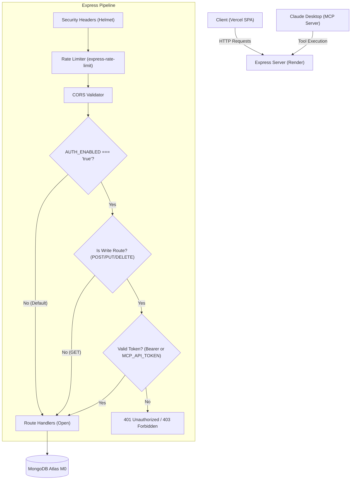

# Authentication & Security Design Specification

**Project:** CampusConnect • Three-Tier Student Management System  
**Branch:** `ui-polish`  
**Status:** Architecture Specification & Implementation Plan  

---

## 1. Executive Summary

This document specifies the authentication and authorization design for the CampusConnect Student Management System. 

The architecture supports a **switchable authentication model** governed by the environment variable `AUTH_ENABLED`:
- **Default Mode (`AUTH_ENABLED=false` or unset):**
  - Read & Write endpoints operate in open evaluation mode.
  - Zero disruption to existing production deployments, continuous evaluation pipelines, or automated test runners.
- **Enforced Mode (`AUTH_ENABLED=true`):**
  - Read endpoints (`GET /api/health`, `GET /api/students`, `GET /api/students/:id`, `GET /api/students/stats`) remain public for transparent portfolio demonstration.
  - Mutation endpoints (`POST /api/students`, `PUT /api/students/:id`, `DELETE /api/students/:id`) require authentication.
  - Supports dual credential validation: **Bearer JWT** (for admin user sessions) or **API Secret Token** (`MCP_API_TOKEN` for the Model Context Protocol server).

---

## 2. Threat Model & Constraints

| Factor | Constraint / Requirement |
| :--- | :--- |
| **Budget** | ₹0 / $0. Only free, open-source, standard cryptographic libraries (e.g. Node standard `crypto` or lightweight JWT). |
| **Deployment Safety** | Render backend must not break when deployed with existing environment variables. |
| **MCP AI Server Compatibility** | Claude Desktop and other MCP clients must be able to perform write operations by supplying `MCP_API_TOKEN` in the request header. |
| **Testing** | Node test runner (`node:test`) must execute without requiring complex authentication mocking unless specifically testing auth. |

---

## 3. Architecture Overview



---

## 4. Endpoint Authorization Matrix

| Endpoint | Method | `AUTH_ENABLED=false` | `AUTH_ENABLED=true` | Required Scope |
| :--- | :---: | :---: | :---: | :--- |
| `/api/health` | `GET` | Public | Public | None |
| `/api/students` | `GET` | Public | Public | None |
| `/api/students/:id` | `GET` | Public | Public | None |
| `/api/students/stats` | `GET` | Public | Public | None |
| `/api/students` | `POST` | Public | Protected | `admin` or valid `MCP_API_TOKEN` |
| `/api/students/:id` | `PUT` | Public | Protected | `admin` or valid `MCP_API_TOKEN` |
| `/api/students/:id` | `DELETE` | Public | Protected | `admin` or valid `MCP_API_TOKEN` |

---

## 5. Token Verification Logic

When `AUTH_ENABLED=true`, mutation requests must provide an `Authorization` header:

```http
Authorization: Bearer <TOKEN>
```

The authentication middleware checks the token against:
1. `MCP_API_TOKEN` / `API_SECRET_KEY`: A shared secret configured in the environment. If the supplied bearer token matches this value, the request is authorized with the role `mcp-agent`.
2. `ADMIN_API_TOKEN`: A pre-shared administrative bearer token. If matched, the request is authorized with the role `admin`.

If the token is missing, invalid, or expired:
```json
{
  "success": false,
  "message": "Unauthorized: A valid Bearer token is required for write operations."
}
```

---

## 6. MCP Server Integration

The MCP server (`mcp-server/index.js`) reads `MCP_API_TOKEN` from its local `.env` or process environment:
```javascript
const getAuthHeaders = () => {
  const token = process.env.MCP_API_TOKEN;
  return token ? { Authorization: `Bearer ${token}` } : {};
};
```
These headers are passed to `fetch()` in all mutation operations (`create_student`, `update_student`, `delete_student`).

---

## 7. Migration & Rollout Checklist

1. [x] Architectural design document created (`docs/AUTH_DESIGN.md`).
2. [x] Implement optional auth middleware in `server/middleware/auth.js`.
3. [x] Integrate rate-limiting and security headers.
4. [x] Update MCP server to send auth header when configured.
5. [x] Verify existing test suite runs cleanly with `AUTH_ENABLED=false`.
6. [x] Add targeted unit test for auth middleware when `AUTH_ENABLED=true`.
