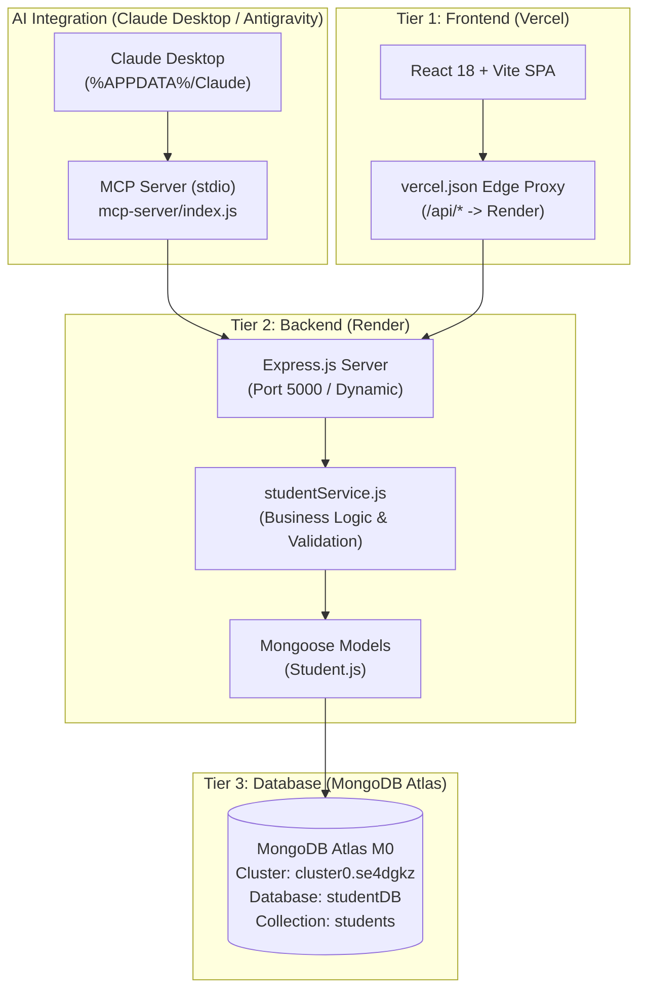

# Codebase Inspection & Quality Audit Report

**Date:** 2026-10-25  
**Repository:** `https://github.com/co2023smniyazi/three-tier-student-management-system`  
**Branch:** `ui-polish` (forked from `main`)  
**Stack:** React 18 + Vite (Frontend), Node.js + Express + Mongoose (Backend), MongoDB Atlas (Cloud Database), `@modelcontextprotocol/sdk` (MCP Server)  
**Deployments:** Vercel (Frontend), Render (Backend)

---

## 1. Architecture Overview



---

## 2. Test Execution & Baseline Status

All existing automated test suites were executed on the unmodified codebase before making any changes:

```
> three-tier-student-management-system@1.0.0 test
> npm run test --prefix server && npm run test --prefix mcp-server

> student-management-server@1.0.0 test
> node --test tests/**/*.test.js

▶ Backend API & Validation Test Suite
  ✔ rejects student with missing required fields (1.15ms)
  ✔ rejects invalid email format (0.22ms)
  ✔ accepts completely valid student payload (0.28ms)
  ✔ allows partial fields for update validation (0.12ms)
  ✔ GET /api/health responds with status and database property (49.16ms)
  ✔ GET / responds with API greeting and endpoints info (8.96ms)
  ✔ POST /api/students returns 400 for invalid data (272.15ms)
  ✔ GET /api/nonexistent-route returns 404 (3.78ms)
  ✔ CORS headers allow localhost origins (3.59ms)
  ✔ CORS headers allow Vercel domains (4.35ms)
  ✔ Concurrent calls to connectDB reuse the same in-flight promise (3534.41ms)
✔ Backend API & Validation Test Suite (4840.50ms)

▶ MongoDB Atlas Live Integration & CRUD Verification
  ﹣ Verifies MongoDB connection state (Skipped - RUN_LIVE_DB_TESTS not set)
  ﹣ 5 Live CRUD tests skipped safely to prevent mutating production database
✔ MongoDB Atlas Live Integration & CRUD Verification (5.23ms)

> student-management-mcp-server@1.0.0 test
> node --test tests/**/*.test.js

▶ MCP Server Tool Discovery and Execution
  ✔ Requirement 13: MCP tools are discoverable via listTools (7.11ms)
  ✔ Requirement 14: MCP tool list_students executes successfully (62.25ms)
  ✔ Requirement 14: MCP tool get_student executes successfully (10.06ms)
  ✔ Requirement 14: MCP tool create_student executes successfully (14.99ms)
  ✔ Requirement 14: MCP tool update_student executes successfully (8.68ms)
  ✔ Requirement 14: MCP tool delete_student executes successfully (7.56ms)
  ✔ Requirement 3: MCP tools validate input strictly (3.11ms)
✔ MCP Server Tool Discovery and Execution (128.02ms)

▶ MCP and REST API Data Synchronization Test Suite
  ✔ Record created via website REST API is immediately visible in MCP tool (76.95ms)
  ✔ Record updated via MCP tool update_student is immediately reflected on REST API (15.46ms)
  ✔ Record deleted via MCP tool is removed from REST API (10.11ms)
✔ MCP and REST API Data Synchronization Test Suite (120.03ms)

Baseline Summary: 21 Passed, 0 Failed, 6 Live DB Tests Skipped. Exit Code: 0.
Vite Client Build: Built in 1.07s (151.44 kB JS bundle gzip: 48.61 kB). Exit Code: 0.
```

---

## 3. Secret Audit & Integrity Check

An exhaustive audit of Git commit logs (`git log -p -S`) and all tracked files was conducted:
* **MongoDB URIs & Passwords:** Zero occurrences of real database credentials or cluster connection strings found in Git history. All committed files use sanitized placeholders (`mongodb+srv://<username>:<password>@cluster0.example.mongodb.net/studentDB`).
* **API Tokens (GitHub, Vercel):** No personal access tokens or keys are committed. Tracked config files use explicit placeholders (`YOUR_GITHUB_PERSONAL_ACCESS_TOKEN`, `YOUR_VERCEL_TOKEN`).
* **Environment Files:** All `.env` and `.env.*` files are properly listed in `.gitignore` and untracked.

> [!NOTE]
> No real secrets were discovered in the Git repository or commit history. Key rotation is not required at this time.

---

## 4. Identified Quality & Security Issues

| Category | Severity | Issue Description | Impact |
|---|:---:|---|---|
| **Security** | **High** | **Unauthenticated Write Endpoints:** `POST`, `PUT`, and `DELETE` on `/api/students` accept requests from any origin without authentication or token checks. | Anyone with the backend URL can modify or delete production student records. |
| **Security** | **Medium** | **Permissive CORS Wildcard Regex:** `server/server.js` uses `/\.vercel\.app$/.test(origin)` which allows *any* third-party project hosted on Vercel to make cross-origin requests. | Malicious websites deployed on Vercel can access and mutate data. |
| **Security** | **Medium** | **Missing HTTP Security Headers & Rate Limiting:** No `helmet` middleware and no request rate-limiting (`express-rate-limit`). | Vulnerable to clickjacking, MIME sniffing, and brute-force/DoS attacks. |
| **Architecture** | **Medium** | **Hardcoded Local Paths in Committed Configs:** `claude_desktop_config.json` in the Git repository contains local machine paths (`D:\New folder\cc project 1\...`). | Cloned repositories will contain developer-specific local paths in version control. |
| **Frontend / UX** | **Medium** | **Monolithic Component:** `client/src/App.jsx` (379 lines) contains all form state, table rendering, notifications, search, and API calls in a single file. | Difficult to maintain, test, and style; lacks reusability. |
| **Frontend / UX** | **Medium** | **Lack of Cold-Start Feedback:** Render free-tier services spin down after 15 minutes. When a user first opens the app, requests may take 30–50s without informative status feedback. | Users perceive the app as broken or hanging during cold starts. |
| **Frontend / UX** | **Low** | **No Dark Mode or Design System:** Color styles are hardcoded with limited CSS variables; no dark theme toggle or accessibility considerations. | App lacks polish for modern portfolio standards. |
| **Backend API** | **Low** | **Missing Stats and Pagination:** `GET /api/students` returns all records without pagination, and there is no aggregate endpoint for dashboard metrics. | Dashboard must compute client-side metrics and cannot handle large datasets efficiently. |

---

## 5. Prioritized Improvement Plan

### Phase 1: UI/UX Redesign (`client/`)
1. **Component Decomposition:** Split `App.jsx` into modular components (`Header`, `StatsCards`, `SearchBar`, `FilterChips`, `StudentTable`, `StudentFormModal`, `ConfirmDialog`, `Toast`, `EmptyState`, `Skeleton`, `Footer`).
2. **Custom Hooks:** Implement `useStudents` (data fetching, state, caching), `useDebounce` (search queries), and `useTheme` (light/dark mode with `localStorage` persistence and `prefers-color-scheme` support).
3. **Design System:** Expand CSS tokens in `index.css` for palette, spacing, typography (system font stack with Inter fallback), shadows, and dark mode variables.
4. **Interactive Dashboard:** Add metric cards (total enrolled, department count, average semester, recently enrolled) and lightweight SVG distribution charts.
5. **Table Enhancements:** Add column sorting, pagination controls, department filter chips, mobile card layout, and sticky headers.
6. **Polished UX & Accessibility:** Semantic HTML, ARIA attributes, keyboard navigation (`Esc` to close modals), accessible color contrast, cold-start indicator with countdown/spinner, and CSV export.

### Phase 2: Backend Hardening (`server/`)
1. **Security Middleware:** Add `helmet` with safe CSP defaults, `express-rate-limit` (100 req/15min on public routes, 30 req/15min on write routes), and body limits (`50kb`).
2. **Strict CORS Allowlist:** Restrict CORS to explicit URLs defined in `FRONTEND_URL` and `localhost` in development.
3. **Pagination & Stats Endpoints (Backward Compatible):** Add optional `page`, `limit`, and `sortBy` query parameters to `GET /api/students`. Implement `GET /api/students/stats` returning aggregate counts by department and semester.
4. **Configurable Authentication for Writes:** Document design in `docs/AUTH_DESIGN.md`. Implement a switchable JWT-based auth guard (`AUTH_ENABLED=false` by default) with an admin login route and `MCP_API_TOKEN` support for the MCP server.
5. **Enhanced Diagnostics:** Upgrade `/api/health` with process uptime, memory metrics, and API version.

### Phase 3: MCP & Configuration Hygiene
1. Replace committed `claude_desktop_config.json` and `.agents/mcp_config.json` with `.example` templates.
2. Update `.gitignore` to protect real developer configuration files.
3. Add optional Bearer token authorization to `mcp-server/index.js` when `AUTH_ENABLED=true`.

### Phase 4: DevOps & CI
1. Create `.github/workflows/ci.yml` running linting, backend tests, MCP tests, and client build on pull requests and pushes.
2. Add `.editorconfig` and Prettier configuration.
3. Run `npm audit` and document dependency status.

### Phase 5: Documentation & Presentation
1. Write `docs/DEMO_SCRIPT.md` (structured 3-minute walkthrough).
2. Write `docs/REPORT_DRAFT.md` (portfolio report skeleton).
3. Add `LICENSE` (MIT) and `CONTRIBUTING.md`.
4. Polish `README.md` with updated architecture diagrams, security notes, API docs, and verified free-tier limitation citations.

